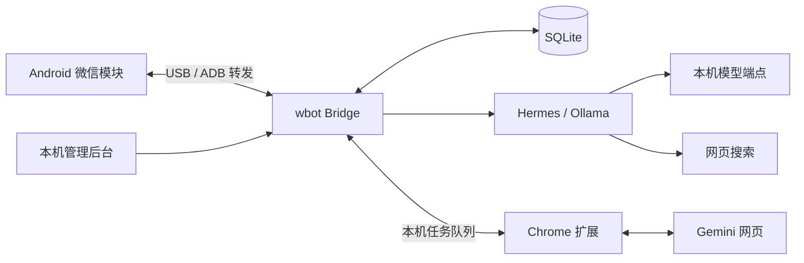

# wbot

运行在本机的微信多群机器人桥接服务。默认机器人名称为 **Nila**，提供群授权、成员独立记忆、管理后台、模型切换、联网搜索和 Gemini 网页生图。

主链路使用 Android 真机代码接口收发微信消息，不依赖截图或 OCR。项目包含版本绑定的 Android 模块源码，**不包含微信 APK、修改版安装包、第三方工具二进制、登录数据或模型权重**。这是实验性接入方案，不是微信官方开放 API。

## 功能

- **多群授权**：群成员发送 `/signup` 发起申请，后台批准后才启用。
- **成员记忆**：按成员微信 ID 跨群共享，Hermes 原生管理成员资料、长期笔记和历史对话；不同账号隔离，同名不合并。群授权、模型配置仍各自独立。
- **统一管理员**：一个微信账号管理所有群的模型、启停和管理员菜单；普通成员管理自己的记忆。
- **管理后台**：群聊、成员、模型、任务状态、密码登录与本机快捷登录。
- **模型接入**：Ollama；Hermes + 本地 Ollama 或本机兼容 API；保留可选 OpenClaw 适配器。
- **联网搜索**：Hermes 按问题判断是否需要 `web_search`，回答携带实际来源。
- **图片生成**：`/img 提示词`，Gemini 网页生成后通过手机接口发送图片；文字拒绝说明也会返回原群。
- **个人生图会话**：同一成员在同一群沿用自己的 Gemini 对话，`/newimg` 重开；不同成员、不同群隔离。
- **发送确认**：代码模式只有微信消息状态和服务器消息 ID 均满足条件才标记成功；不确定结果不自动重发。

## 架构



| 目录 | 内容 |
| --- | --- |
| `apps/server` | TypeScript 服务、授权、队列、记忆与模型适配 |
| `apps/admin` | 无构建依赖的管理页面 |
| `apps/gemini-extension` | Gemini 网页生图扩展，当前版本 1.1.1 |
| `apps/android-wechat-module` | Android 微信进程内代码桥接模块 |
| `apps/android-hook-probe` | 独立 Hook 自检 App |
| `apps/android-companion` | 早期通知能力诊断 App，不是当前收发通道 |
| `packages/shared` | 共享类型 |
| `config` | 可提交的配置模板 |
| `scripts` | 初始化、构建、诊断与本机服务工具 |
| `tests` | 服务、权限、队列、浏览器与旧设备适配器测试 |
| `docs` | 部署、命令、架构、API 和兼容性说明 |

## 快速启动管理后台

需要 Node.js **22.13+** 和 npm；完整检查还需要 JDK **17+**。以下使用 mock 设备，不连接真实微信、不发送消息。

```bash
npm ci
npm run setup
npm run check
npm run build
npm start
```

另开一个终端，在项目目录运行：

```bash
npm run admin
```

管理页默认地址为 `http://127.0.0.1:3100/`。`npm run setup` 生成随机 API Token，已有 `.env` 和设备配置不会被覆盖。

需要密码登录时，在服务首次启动、数据库已建立后执行：

```bash
python3 scripts/set-admin-password.py
```

## 接入真实微信

按 [部署说明](docs/deployment.md) 配置 Android 模块、USB 转发和模型，再将 `WECHAT_DEVICE_MODE` 切换为 `android_hook`。不要直接把 mock 验证当作真实微信验收。

1. 在自己的测试设备上完成模块适配和登录。
2. 配置手机接口 Token、设备序列号和统一管理员微信号。
3. 在目标群发送 `/signup`，后台批准该群。
4. 启用自动回复，先验证一条文字和一张图片的发送回执。

设备接入与模型是独立的：运行普通文本聊天不必启用 Gemini 扩展；浏览器生图需要 Chrome 运行且 Gemini 已登录。

## 常用命令

```text
/help                 查看当前权限对应的菜单
/signup               提交本群使用申请
/img 提示词            在自己的生图对话中生成图片
/newimg               重开自己的本群生图对话
/memory               查看自己的记忆状态
/remember 内容         添加自己的长期记忆
/forget               清空自己的长期记忆
/reset                清空自己的上下文和长期记忆
```

管理员另有 `/models`、`/model`、`/status`、`/new`、`/stop`、`/start`。完整权限和作用范围见 [命令说明](docs/commands.md)。

## 图片会话

图片请求串行使用一个专用 Gemini 标签页，最多保留 10 个未完成请求。后台只向扩展发送提示词和随机会话 ID，不发送微信账号、群名、长期笔记或群记录。

同一成员在同一群可以连续发送：

```text
/img 画一只戴黄色帽子的紫色鲸鱼
/img 把上一张的背景改成蓝色
/newimg
/img 画一个苹果
```

`/newimg` 会取消自己的旧会话中尚未完成的图片任务；已存在的 Gemini 历史对话不会被删除。扩展 1.1.1 修复了 Gemini 重建消息节点后无法识别已完成图片的问题。

## 验证与限制

```bash
npm run check
python3 -m unittest discover -s tests -p '*_test.py'
```

`npm run check` 包含 Android 文字发送回执测试，需要 JDK 17+（通过 `JAVA_HOME`、本机 `.runtime/java` 或 PATH 查找）；可用 `npm run test:android` 单独运行。Python 测试需要 `requirements.txt` 中的依赖。单元测试不需要微信登录或 Gemini 会员；真实接入需要独立验收。

安装 Hermes 后，可单独运行 `python3 -m unittest discover -s tests -p hermes_memory_test.py -v` 验证原生成员记忆。该测试使用虚构资料和临时目录，不调用模型、不发送微信消息。

- Android 模块当前适配微信 **8.0.79 / versionCode 3200**，其他版本不保证兼容。
- Gemini 网页受登录状态、额度、网页更新和浏览器休眠影响，不是稳定的官方图片 API。
- 当前回传网页显示的生成图，通常约 1024 像素；不保证为“下载完整尺寸”原图。
- 生图输入已取消原 2000 字限制；手机模块仍有整条原始消息 8000 个 UTF-16 单元的上限。
- Mac 服务会抑制自动休眠并允许锁屏，但网页生图的锁屏运行尚未完成独立验收；系统休眠或手机断开会影响工作。
- 历史 `adb` 视觉适配器保留用于研究，当前代码接入不会自动回退到截图/OCR。

更多内容：[部署](docs/deployment.md) · [架构](docs/architecture.md) · [API](docs/api.md) · [兼容性](docs/compatibility.md) · [数据与凭证](docs/security.md) · [第三方依赖](THIRD_PARTY.md)
